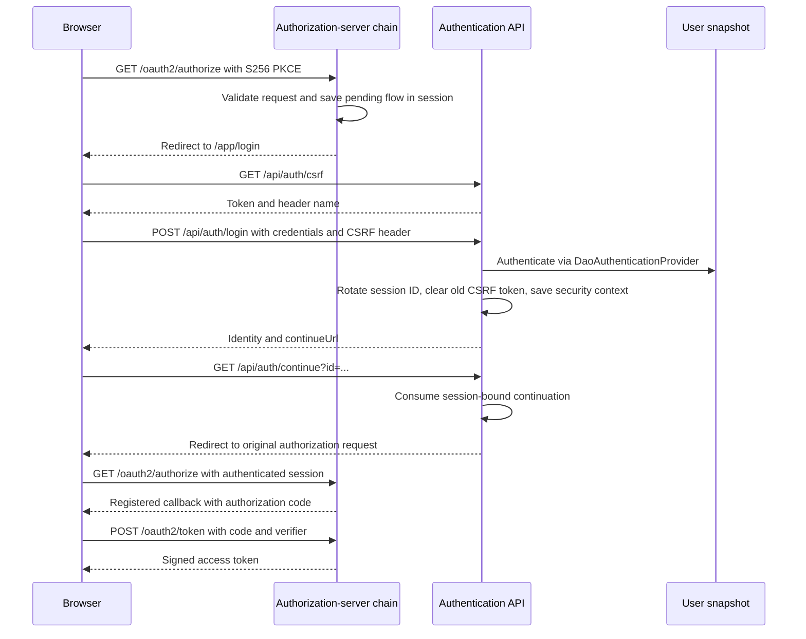

# Authorization server code analysis

Analysis date: 2026-10-28. This document describes the implementation in this
repository. The [original design](oauth2-auth-server.md) records the intended
architecture and still labels implementation as not started; this document is a
separate implementation companion.

## Overall structure

The application is a Java 17 / Spring Boot 4.0.9 service. Spring supplies the
OAuth2 protocol implementation, while project code supplies JSON login, user
loading, authorization policy, session continuation, and signing-key management.
The login webapp and resource server are separate applications.

| Source | Responsibility |
| --- | --- |
| `AuthServerApplication` | Boot entry point and `AuthProperties` registration |
| `config/AuthProperties` | Typed binding of issuer, clients, users, keys, and role-to-scope policy |
| `config/SecurityConfiguration` | Two security chains, authentication manager, client registrations, scope validation, and JWT customization |
| `config/SigningKeys` | Load persistent RSA keys or generate a development key |
| `user/JsonUserDetailsService` | Validate the external directory and expose an immutable username-indexed snapshot |
| `authentication/AuthenticationController` | CSRF bootstrap, JSON login, session identity, and continuation |
| `authentication/PendingAuthorization` | Store one expiring, single-use authorization continuation per session |
| `authentication/LoginRateLimiter` | Process-local account and source attempt limits |
| `authentication/ApiError`, `AuthenticationApiAdvice` | Safe JSON errors for application endpoints |
| `tools/PasswordHash` | Interactive offline bcrypt hash generation |

Paths in this table are relative to `src/main/java/io/ytong/authserver/`.
Runtime defaults are in `src/main/resources/application.yaml`; local overrides
are in `application-dev.yaml`.

## SecurityConfiguration: how requests are routed

### Authorization-server chain, order 1

`authorizationChain` matches the endpoints exposed by Spring's authorization
server configurer. Spring handles authorization codes, token exchange, discovery,
JWKS, introspection, revocation, and client authentication. Disabling generic HTTP
Basic login does not remove the protocol's `client_secret_basic` authentication.

The custom authorization-request validator requires:

- An explicit redirect URI equal to a registered URI.
- Scopes accepted by Spring's client-scope validator and a nonempty scope set.
- PKCE method `S256` and a 43-character base64url challenge.
- For authenticated users, an enabled directory entry and permission for every
  requested scope through the union of that user's configured roles.

An unauthenticated valid browser authorization request is saved in its session
and redirected to the configured `/app/` login path. Continuation returns the
browser to `/oauth2/authorize`, where the protocol request is evaluated again.
Authorization endpoint failures use local JSON HTTP 400 responses, including
failures that might otherwise be returned to a valid client callback. A webapp
must account for this error behavior.

`TokenExchangeLock` synchronizes the entire downstream handling of requests whose
URI is `/oauth2/token`. This prevents simultaneous code exchange within this
process from passing the same code through the in-memory state concurrently.
The lock serializes unrelated token requests too, including client-secret
verification, making token throughput dependent on the slowest request holding
the lock. It does not coordinate multiple server instances.

### Application chain, order 2

`applicationChain` permits unauthenticated access to CSRF bootstrap and login,
requires authentication for session/continuation/logout paths, and denies other
application routes. It disables generated form login, generic HTTP Basic login,
and saved-request caching. Authentication and access-denied errors are JSON.

CSRF protection remains enabled for browser mutations. Logout is implemented by
Spring's logout filter at `/api/auth/logout`, rather than a controller method;
it invalidates the session, clears `JSESSIONID`, and returns 204.

Both chains use the same session-backed `SecurityContextRepository`. This is
what lets credentials verified through the application API authenticate a later
request handled by the authorization-server chain.

## Login and continuation lifecycle

`AuthenticationController.login` reads at most 4,097 bytes to enforce a 4 KiB
body limit. Its strict JSON mapper rejects duplicate keys and trailing tokens.
The object must contain exactly `username` and `password`, both strings.
Usernames match `[A-Za-z0-9._@-]{1,128}`. Passwords must be nonempty, contain no
NUL, and fit within 72 UTF-8 bytes; the limit is bytes rather than Java characters.

After validation and rate limiting, the controller delegates to an
`AuthenticationManager` backed by `DaoAuthenticationProvider`. The configured
provider checks enabled status after password verification, avoiding the early
disabled-account rejection path. Unknown users, disabled users, and incorrect
passwords receive the same `invalid_credentials` response. Equal error responses
do not establish equal execution timing, especially with different bcrypt costs.

On success, the controller explicitly invokes the session authentication
strategy, creates a security context, and saves it through the shared repository.
The strategy changes an existing session ID and clears the old CSRF token. The
browser fetches a new CSRF token before its next mutation. Login returns only
stable ID, username, and an optional continuation URL; token issuance happens
through the separate code exchange.

`PendingAuthorization` stores a UUID, a local authorization path with the original
query, and a five-minute expiry. It accepts only GET `/oauth2/authorize` with a
query of at most 8,192 characters. Saving another request replaces the previous
flow. Consumption checks the ID against the current session and removes the
entry under a session monitor before returning the target. Missing, expired,
replaced, and reused continuations return `authorization_expired`. This class
enforces storage and continuation constraints; protocol validation belongs to
the authorization-server chain.

## JsonUserDetailsService: data contract and authentication bridge

The service loads the configured file once during construction and rejects the
entire directory on any invalid record. It reads at most 1 MiB plus one byte to
detect oversized input. No file watcher or write API exists.

| Constraint | Implementation |
| --- | --- |
| Root schema | Exactly `schemaVersion` and `users`; version must be integer 1 |
| User count | Between 1 and 10,000 |
| Record fields | Exactly `id`, `username`, `passwordHash`, `enabled`, and `roles` |
| Stable ID | Unique; `[A-Za-z0-9._-]{1,128}` |
| Username | Unique and case-sensitive; same syntax as the login API |
| Password hash | `{bcrypt}` prefix, bcrypt variant 2a/2b/2y, cost 10 through 16, expected encoded shape |
| Enabled flag | Required JSON boolean |
| Roles | At most 32, no duplicates, all present in the configured role-policy keys |
| JSON parsing | Duplicate keys, trailing content, and unknown/missing fields rejected |

An empty role list is valid: such a user can log in but cannot obtain a token
for a scope that requires a role. There is no implicit role assignment in code.

`Map.copyOf` and `Set.copyOf` make the loaded snapshot immutable. `entry` returns
the application record; `loadUserByUsername` converts it into Spring
`UserDetails` and adds the `ROLE_` prefix through Spring's `roles` builder.
The principal name remains the username. JWT customization resolves that name
back to the entry and uses its immutable ID as `sub`.

Load failures deliberately discard parser exception causes to avoid exposing
credential data. This protects diagnostics but means operators receive one
generic startup error for missing files, malformed JSON, and invalid records.
The code checks ID uniqueness within a snapshot; preserving IDs across edits is
an operator responsibility.

## Clients, JWTs, and keys

Client registrations are constructed at startup and stored in memory. All use
only the authorization-code grant, require PKCE, and skip interactive consent.
A missing or blank secret hash selects a public client; a supplied bcrypt hash
selects `client_secret_basic`. Redirect URIs must use HTTPS, with HTTP allowed
for loopback hosts, and cannot contain wildcards, credentials, queries, or fragments.
The shared URL validator also applies those restrictions to the issuer.

Client scopes must appear somewhere in the role-to-scope policy. At authorization
time, the user must be allowed every requested scope; the server rejects an
excessive request instead of silently trimming it.

Codes last 60 seconds and self-contained access tokens last five minutes. The
JWT customizer sets `RS256`, `typ=at+jwt`, the active key ID, stable user `sub`,
configured audience, and `client_id`. Other standard claims and authorized scopes
come from Spring's token generator. No refresh-token grant or OIDC configuration
is enabled. The token settings' `idTokenSignatureAlgorithm` call alone does not
enable OIDC or cause ID tokens to be issued.

`SigningKeys` loads a PKCS12 keystore, requires an active private RSA key of at
least 2,048 bits, and uses its alias as `kid`. Other certificate-only RSA entries
are available for public-key publication without becoming signing candidates.
The explicit ephemeral setting generates a random 2,048-bit RSA key and logs a
warning. The dev profile turns that setting on; the bean itself does not restrict
the setting to that profile, so deployment configuration must control it.

## State and deployment consequences

| State | Storage and consequence |
| --- | --- |
| User records | External JSON, immutable in memory until restart |
| Client registrations | Configuration, in-memory repository |
| Browser identity and pending flow | Servlet session; no shared session store configured |
| Codes, grants, token status | `InMemoryOAuth2AuthorizationService`; lost on restart |
| Login attempt windows | Timestamp queues under 64 ordered lock stripes; reset on restart |
| Signing material | External keystore by default; survives restart if retained |

Persistent keys allow an already-issued JWT to remain signature-verifiable after
a restart, even though server-side grant state is gone. Logout and revocation
do not immediately invalidate tokens at APIs that validate JWTs locally. User
changes require restart and cannot revoke those tokens by themselves.

The default configuration uses port 9000, a 15-minute session idle timeout,
HttpOnly/SameSite=Lax cookies, and Secure cookies unless overridden. The dev
profile disables Secure cookies for local HTTP. Forwarded headers are ignored.
The webapp must be routed separately under the same public origin; this service
does not implement `/app/login` or the callback UI. No CORS policy is configured.

## Review observations and follow-up work

These observations distinguish implemented limits from areas needing further
verification; they are not a claim of a complete security audit.

1. **Token exchange has a global throughput limit.** The process-wide lock is a
   practical single-instance replay defense, but a scalable implementation needs
   atomic code consumption in shared durable storage rather than this lock.
2. **Rate limiting is bounded and process-local.** Updated on 2026-10-29 to use
   timestamp queues for sliding 60-second windows and a monotonic ticker. Each
   request locks only its source/account stripes in index order, and prunes only
   its two queues. Atomic capacity reservation enforces 10,000 keys, including
   concurrent insertions; existing keys remain usable at capacity. Capacity
   pressure triggers a sweep at most once per second, locking one stripe at a
   time; other callers skip an in-progress sweep and may receive 429 until space
   is reclaimed. Saturated queues do not retain further rejected attempts, so
   memory stays bounded and such attempts do not extend that key's lockout.
   Stripe collisions still cause some contention. Use upstream source limits
   behind a proxy because `getRemoteAddr()` identifies the direct peer.
3. **Configuration errors are only partly structured.** `AuthProperties` has no
   declarative validation, and several consumers assume non-null nested records,
   maps, and lists. Explicit validation could make incomplete external
   configuration fail with clearer field-specific errors.
4. **Cache-header behavior deserves explicit assertions.** JSON errors and logout
   explicitly set `Cache-Control: no-store`; successful controller responses rely
   on Spring Security's configured default header behavior. Assert headers for
   CSRF, login, session, and continuation responses to preserve the intended
   no-store contract through future configuration changes.
5. **Directory validation has a deliberate diagnostic tradeoff.** Preserve safe
   startup messages, but consider non-sensitive categories such as unreadable
   file versus invalid schema if operator troubleshooting becomes difficult.

## Test evidence and limits

The repository contains 20 JUnit test methods across five test classes:

| Test class | Behavior inspected in source |
| --- | --- |
| `AuthServerIntegrationTests` (8) | Login persistence and session-ID rotation; logout and CSRF; generic credential errors; malformed/oversized login; full continuation/code/JWT flow; invalid redirect, scope, and PKCE; wrong verifier and unsupported password grant; discovery; confidential client authentication; introspection/revocation; expired codes and concurrent replay |
| `JsonUserDetailsServiceTests` (2) | Invalid schema/data rejection without credential leakage; immutable snapshot and reload through a new instance |
| `SigningKeysTests` (2) | Stable key loading, retired certificate publication, and missing production key configuration |
| `LoginRateLimiterTests` (7) | Account/source limits, sliding boundaries, expiry/capacity recovery, and concurrent limits/capacity |
| `PendingAuthorizationTests` (1) | Session binding, replacement, and expiry using a controllable clock |

Tests use MockMvc, temporary user data, generated bcrypt hashes, and temporary
key material. They provide useful protocol and application coverage but do not
exercise a real browser, deployed reverse proxy, resource server, or multiple
instances. Additional useful checks include cookie attributes in a running
container, cache headers, detailed invalid configuration,
and resource-server rejection of expired tokens.

Validation on 2026-10-28: `mvn verify -q` completed successfully. Surefire reports
15 tests, zero failures, zero errors, and zero skipped tests.
