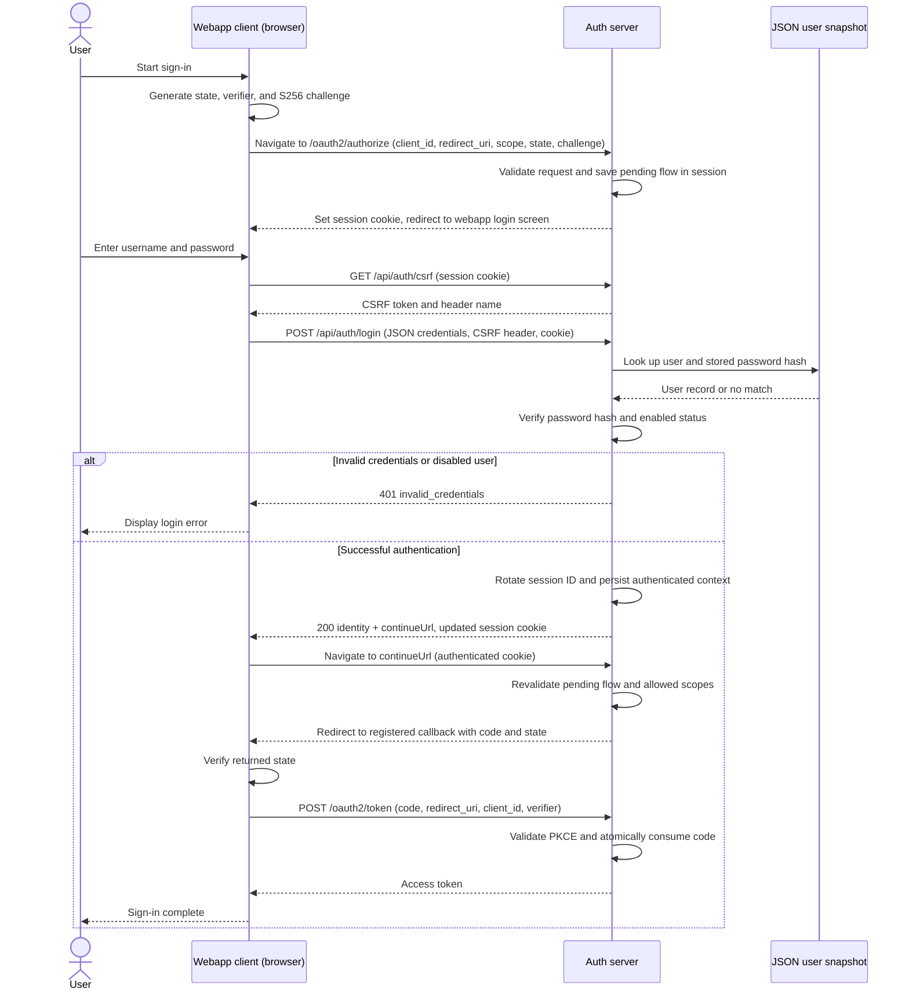

# OAuth2 authorization server

Status: proposed design for review. Implementation has not started.

## Goal and scope

Implement a single-instance OAuth2 authorization server using Spring Boot,
Spring Security authorization server support, and Maven. Maintain users in an
operator-managed JSON file. A separately implemented first-party webapp owns the
login UI and submits username and password to this server's JSON authentication
API. This server provides no login page. The API verifies credentials against the
JSON directory using Spring Security password encoding and authentication support;
Spring's authorization server support handles the OAuth2 protocol.

OAuth2 delegates access to APIs. User login authenticates the resource owner
inside this service; OpenID Connect (OIDC), which exposes identity to clients,
is outside the initial scope. Do not issue ID tokens or advertise OIDC endpoints.

Version one supports: Authorization Code with S256 PKCE for registered public and
confidential clients, signed JWT access tokens, discovery, JWKS, revocation,
and introspection. Defer refresh tokens, client credentials, dynamic client
registration, registration/password-reset APIs, MFA, and federation.
Do not enable implicit or resource-owner-password grants.

## Architecture and responsibilities

| Component | Responsibility |
| --- | --- |
| First-party webapp | Login UI, credential submission, OAuth2 state and PKCE handling |
| Authentication API | Verify credentials, establish user sessions, expose session/logout operations |
| Spring authorization server | Validate OAuth2 requests, issue authorization codes and access tokens |
| JSON user directory | Store user IDs, usernames, password hashes, enabled status, and roles |
| Resource server (API) | Validate access tokens and enforce audience and scope |

The authentication API establishes a browser session. The OAuth2 token endpoint
issues an access token after a separate authorization-code exchange.

### Deployment boundary

Expose the webapp and authentication/OAuth2 paths through one public origin using
a reverse proxy, while keeping their implementations separate. This avoids
cross-site session-cookie dependencies. A separate-origin deployment requires
explicit credentialed CORS and a cookie/CSRF review before use.

Configure the canonical issuer explicitly (local default `http://localhost:9000`).
Use HTTPS outside loopback development and trust forwarded headers only from
configured proxies.

## Technology and project layout

- Java 17 and Maven, using Spring Boot 4.0.9 dependency management.
- `spring-boot-starter-security-oauth2-authorization-server` supplies protocol support.
- Use the Boot-managed JSON mapper for the user file and Spring's
  `DelegatingPasswordEncoder` for encoded passwords.
- Use in-memory client registrations, OAuth2 authorization state, and browser
  sessions initially. JSON stores users only.

Planned packages under `io.ytong.authserver`:

| Package | Responsibility |
| --- | --- |
| `config` | Ordered security filter chains, client registration, issuer, signing keys |
| `user` | JSON schema, validation, immutable user snapshot, `UserDetailsService` |
| `authentication` | JSON login, session inspection, CSRF bootstrap, and logout APIs |

Keep protocol logic in Spring. Do not implement custom token or authorize controllers.

## Authentication and authorization sequence

This sequence shows an unauthenticated public browser client. If the session is
already authenticated, authorization can continue without prompting for credentials.
Session cookies accompany browser requests to the auth server.



This diagram uses a public browser client, which has no client secret. For a
confidential webapp with a backend, the backend keeps the verifier and exchanges
the code at the token endpoint using its client authentication. The resource server validates the resulting token before allowing API access.

### Flow validation rules

Validate the client, exact redirect URI, response type, scopes, and S256 PKCE
before saving the pending request. An invalid redirect URI produces a local error
rather than a redirect to that URI. Revalidate the request after login.

Bind each authorization code to its client, redirect URI, user ID, granted scopes,
and PKCE challenge. Reject expired, replayed, or incorrectly bound code exchanges.
The client must verify the returned `state` before exchanging the code. Resource
servers validate signature, issuer, audience, expiry, and required scope.

## Endpoint overview

| Endpoint | Purpose |
| --- | --- |
| `GET /oauth2/authorize` | Browser authorization request |
| `POST /oauth2/token` | Authorization-code exchange |
| `GET /.well-known/oauth-authorization-server` | OAuth2 metadata |
| `GET /oauth2/jwks` | Public signing keys |
| `POST /oauth2/introspect` | Token status for authenticated confidential clients |
| `POST /oauth2/revoke` | Revoke stored authorization/token state |
| `GET /api/auth/csrf` | Bootstrap session and obtain CSRF token for the webapp |
| `POST /api/auth/login` | Authenticate JSON credentials and establish session |
| `GET /api/auth/session` | Return minimal authenticated user identity, or 401 |
| `POST /api/auth/logout` | CSRF-protected session logout; return 204 |

## Authentication API

### Login request and response

`POST /api/auth/login` accepts `Content-Type: application/json`:

```json
{"username": "alice", "password": "user-entered-password"}
```

Return `200` with minimal identity and a server-generated `continueUrl` when a
saved OAuth2 request exists; otherwise `continueUrl` is null. Set an HttpOnly
session cookie. The response contains no access token or password data. Login
establishes a user session; access tokens are issued through the authorization-code
flow at `/oauth2/token`.

Use `400` for malformed JSON or invalid field lengths, `401` with the same
`invalid_credentials` response for wrong passwords and unknown/disabled users,
`403` for missing/invalid CSRF, and `429` for rate limiting. JSON error bodies
contain a stable error code and safe message. Bound request sizes and password
length without truncating passwords; avoid timing differences for unknown users.

### Session and CSRF behavior

`GET /api/auth/csrf` returns the CSRF token and required header name. The webapp
sends that header with login/logout requests and includes cookies with API calls.

The login implementation delegates credential verification to an
`AuthenticationManager`, invokes the configured session authentication strategy
to rotate the session ID, and explicitly persists the authenticated
`SecurityContext` through a session-backed `SecurityContextRepository`.
Rotate/renew the CSRF token after login; the webapp fetches a new token before
the next mutation. Logout invalidates the session and clears its cookie.
Session inspection returns only the stable ID and username, never password hashes.
Authentication/session responses use `Cache-Control: no-store`.

### Continuing OAuth2 authorization

Configure the webapp login URL on the server; do not accept arbitrary login or
continuation URLs from callers. Bind saved authorization requests to the browser
session with an expiry. Resume URLs must target this server's validated flow;
never treat an input `returnUrl` as trusted. Expired/missing requests require the
client to restart authorization. Initially support one pending flow per session;
starting another replaces it and the webapp must handle an expired continuation.

## JSON user directory

Read an external file specified by `auth.users.path` (default
`./config/users.json`). Do not package real credentials inside the application.
The intended schema is:

```json
{
  "schemaVersion": 1,
  "users": [
    {
      "id": "user-001",
      "username": "alice",
      "passwordHash": "{bcrypt}<generated-bcrypt-hash>",
      "enabled": true,
      "roles": ["USER"]
    }
  ]
}
```

The hash above is a placeholder, not a usable credential. Generate hashes offline
with a password encoder; never store plaintext passwords or accept `{noop}`.
Initially allow only bcrypt hashes, with work factor calibrated on the deployment
machine. Validate hash format and work factor before accepting the file.

Require schema version 1, nonempty users, unique immutable IDs, unique case-sensitive
usernames, boolean `enabled`, and a bounded allowlist of role names. Reject unknown
fields, malformed records, oversized files, and unsupported password encodings.
Map roles to `ROLE_` authorities once. Use immutable IDs as token subjects; ensure
the Spring JWT customizer maps the authenticated username to its stable user ID.

Load and validate the complete file at startup, then publish an immutable snapshot
through `JsonUserDetailsService`. Fail startup on missing or invalid data; never
fall back to a generated user. Do not log passwords, hashes, or complete records.
Restrict file access to the service account and authorized operators.

Updates use an operator-written temporary file followed by atomic replacement
and an application restart. No file watcher or runtime mutation in version one.
Restart clears browser sessions and OAuth2 authorization state. Already-issued JWT access
tokens remain valid until expiry, including after disabling a user.

## Client configuration and permissions

Keep client registrations separate from user data. Configure explicit client IDs,
exact redirect URI allowlists, permitted scopes, grant types, and client type.
Public clients use authentication method `none`; confidential clients use
`client_secret_basic` with externally supplied encoded secrets. No secrets in Git.

Require S256 PKCE for every authorization-code client. Reject missing PKCE and
the `plain` method. Initially register only trusted first-party clients with explicit
operator-approved scopes and no interactive consent page. Third-party clients and
interactive consent are deferred until a webapp consent flow is designed.
Define an explicit role-to-scope policy; granted scopes must be the
intersection of requested scopes, the client's allowlist, and the user's policy.
Reject scopes outside this set rather than silently granting additional access.

Start with one demo scope, `demo.read`, and one configured API audience,
`demo-api`. Add scopes/audiences through explicit configuration changes.

## Security configuration

Use one high-priority authorization-server filter chain and one application chain
for authentication APIs. Disable Spring's generated form login and HTTP Basic
login for users. Preserve Spring's protocol-specific CSRF handling and protect
session-changing APIs, including login, against CSRF. Authentication APIs return
JSON 401 responses; only browser authorization requests redirect to the configured
webapp login URL. Token endpoint failures return OAuth errors. Deny unrelated
application endpoints by default.

Use HttpOnly, SameSite=Lax session cookies and Secure cookies under HTTPS. Apply
CSRF protection to login and logout. Use generic credential errors and rate-limit
login by account and source without permanent account locking. Never log
passwords, password hashes, authorization codes, access tokens, or session cookies.

## Tokens, keys, and state

- Authorization code lifetime: 60 seconds; access token lifetime: 5 minutes.
- Browser-session idle timeout: 15 minutes. No refresh tokens in version one.
- Sign JWT access tokens with RSA/RS256 and a `kid`. Include stable `sub`, `iss`,
  `aud`, `iat`, `exp`, `jti`, `client_id`, and granted `scope`; follow the JWT access
  token profile. Exclude passwords and unnecessary personal information.
- Persist private signing keys outside Git, using an operator-managed keystore.
  Publish public keys only. Fail startup if configured keys are unavailable.
  An explicit development profile may generate ephemeral keys with a startup notice.
- Rotate keys with overlapping public-key publication until all tokens signed by
  the retired key expire, including permitted clock skew.
- In-memory state limits deployment to one instance. Restarts lose sessions and
  grants. Never claim persistent revocation or horizontal scalability.
- Revocation and logout do not immediately invalidate a JWT at APIs using local
  validation. Immediate invalidation requires authenticated introspection backed
  by shared durable state, or a resource-server denylist, as a later design change.

## Delivery plan and acceptance checks

1. **Scaffold:** Maven parent/dependencies, Boot entry point, port 9000,
   and application-context smoke test. No custom authentication is implemented yet.
2. **Directory and authentication API:** implement schema validation, password
   encoder, `JsonUserDetailsService`, and JSON authentication/session endpoints.
   Test session persistence and ID rotation, JSON errors, valid login, wrong
   passwords, unknown/disabled users, duplicate IDs/usernames, malformed hashes/JSON, and missing files.
3. **Protocol:** configure both filter chains, trusted first-party registered clients,
   scope policy, subject mapping, issuer, and signing keys. Test the complete
   authorization-code flow with a real verifier and validate the resulting JWT.
4. **Negative/security checks:** reject unregistered redirects, unsupported grants,
   missing/plain/wrong PKCE, code replay/expiry, invalid client authentication,
   unauthorized scopes, and missing CSRF tokens on login/logout APIs. Verify
   external webapp login and saved-request continuation, expired continuations,
   rejection of arbitrary continuation URLs, logout behavior, metadata, JWKS,
   introspection authorization, and the documented JWT revocation limitation.
5. **Operational checks:** test key persistence across restart, expired token
   rejection, invalid configuration failure, and replacement user-file loading.
   Document offline password hashing and a local client walkthrough.

Run `mvn verify` for automated checks. Before deployment, move protocol/session
state to durable shared storage if restart persistence or multiple instances are
required. JSON remains suitable only for a small operator-managed user directory.

## References

- [Spring Boot OAuth2 support](https://docs.spring.io/spring-boot/reference/security/oauth2.html)
- [Spring authorization server getting started](https://docs.spring.io/spring-security/reference/servlet/oauth2/authorization-server/getting-started.html)
- [Spring custom authentication and session persistence](https://docs.spring.io/spring-security/reference/servlet/authentication/session-management.html): session strategy and explicit security-context persistence for API login.
- [Boot 4 starter naming and migration](https://github.com/spring-projects/spring-boot/wiki/Spring-Boot-4.0-Migration-Guide)
- [OAuth2 security best current practice, RFC 9700](https://www.rfc-editor.org/info/rfc9700/): basis for PKCE, redirect validation, and excluded grants.
- [Authorization server metadata, RFC 8414](https://www.rfc-editor.org/info/rfc8414/)
- [JWT access token profile, RFC 9068](https://www.rfc-editor.org/rfc/rfc9068.html)
